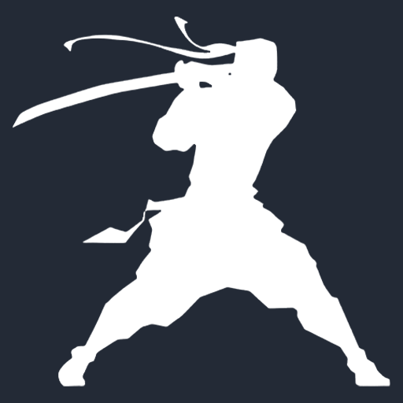
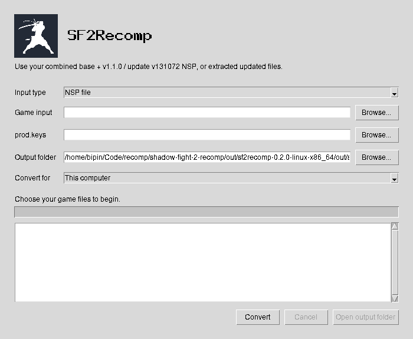

<p align="center">
  
</p>

<h1 align="center">SF2Recomp</h1>

<p align="center">Shadow Fight 2 for Nintendo Switch, running as a native game on your device.</p>

<p align="center">
  <a href="https://github.com/bipinkrish/sf2recomp/releases">Download</a> ·
  <a href="docs/features.md">Features</a> ·
  <a href="#settings-and-controls">Settings</a> ·
  <a href="docs/lan-sparring.md">LAN multiplayer</a> ·
  <a href="docs/source-guide.md">Build from source</a>
</p>

<p align="center">
  <a href="https://playported.com/ports/1207-shadow-fight-2/"></a>
  <a href="https://quiverlauncher.com/apps/shadow-fight-2-sf2recomp"></a>
</p>

Play as Shadow or Titan in Sparring, challenge bosses again, or fight a friend
over LAN. SF2Recomp adds mouse menus, remappable controls, Android touch controls,
and graphics options for high resolutions, high frame rates, and ultrawide displays.

**Bring your own game files. No game code, game assets, or keys are included.**

## Status

You need a compatible **Vulkan 1.3 GPU and graphics driver**. High resolutions
and frame rates depend on your hardware.

| Platform | Requirements |
| --- | --- |
| Linux x86-64 | glibc 2.39+, such as Ubuntu 24.04 or newer. |
| Windows x86-64 | Windows 10 or 11. |
| macOS Apple Silicon | macOS 15+. Experimental; gameplay and GPU validation pending. |
| Android ARM64 / x86-64 | Android 13+ and compatible Vulkan 1.3 features. |

## Get started

You need your own **combined base + v1.1.0 / update v131072 NSP**, including its
CNMT XML sidecars and tickets, plus your `prod.keys` file. Separate base and update
NSPs, NSZ files, and other game versions are not supported. Already extracted
updated game files also work and do not need keys.

1. Download the desktop tool for your computer using **Download** above.
2. Extract the entire archive into a writable folder.
3. Open the launcher for your system:

   | System | Launcher |
   | --- | --- |
   | Windows | `sf2recomp.exe` |
   | Linux | `sf2recomp` |
   | macOS | `SF2Recomp.app` |

4. In the conversion window, browse for your NSP, `prod.keys`, and output folder.
   For extracted files, choose **Extracted game folder** under **Input type**.
5. Leave **Convert for** set to **This computer**, then click **Convert**.
6. When conversion finishes, click **Open output folder**. Open `sf2.exe` on
   Windows, the generated desktop launcher on Linux, or `Shadow Fight 2.app`
   on macOS.

Keep the converted folder's files together. Your settings are in `sf2recomp.ini`,
and your saves are in `save/`. The tool bundles its compiler and FFmpeg decoder;
you do not need to install Python, a compiler, or FFmpeg to use a desktop release.

The tool saves each conversion log as `logs/sf2recomp-conversion-<timestamp>.log`.
The game writes its latest launch log to `logs/shadow-fight-2.log` in the
converted folder on desktop and the game's files directory on Android.
If no release is available, use the source guide linked above.

## Settings and controls

Edit **`sf2recomp.ini` beside the converted executable**, then restart the game.
Use **More settings** below for every section, examples,
controller mappings, save imports, and graphics settings.

| Default key | Action |
| --- | --- |
| `W A S D` | Move |
| `K / J / L / I` | Switch `A / B / X / Y` actions |
| `Tab / Backspace` | Switch `Plus / Minus` actions |

Settings apply at launch, so changing the INI does not require another conversion. <a href="docs/runtime-guide.md">More settings</a>.

## Conversion tool

The desktop launcher opens the converter window automatically. Browse for your
game input and keys, choose where to save the result, then click **Convert**.
The window shows measured progress and the full log. Click **Cancel** to stop
a conversion. **Open output folder** becomes available when conversion succeeds.



## Android

Open the desktop converter and select **Android phone (ARM64)** under **Convert for**.
Read and accept the Android SDK terms, then click **Convert**. Install the resulting
APK on your phone. Use **Android emulator (x86-64)** for an emulator.

First-time Android setup downloads several GB of Java, SDK/NDK, and build tools.
You need an internet connection and enough space in the tool folder. Later builds
reuse those downloads. Android Studio is not required.

## Command line

The launcher also accepts command-line arguments. On Windows, replace
`./sf2recomp` with `sf2recomp.exe`. From an interactive Command Prompt, use
`start "" /wait sf2recomp.exe --check` when you need the prompt to wait for completion.
On Linux, run `./sf2recomp --install-desktop` to add the converter and its icon
to your application menu.

```sh
# Convert and launch the desktop game
./sf2recomp --nsp "/path/game.nsp" --keys "/path/prod.keys" --output "/path/SF2" --play

# Use already extracted updated game files
./sf2recomp --game "/path/extracted/update" --output "/path/SF2"

# Use terminal prompts instead of the conversion window
./sf2recomp --cli
```

## Development

The source guide linked at the top covers dependencies, conversion, and Android builds.
More specific references are available for
[Windows](docs/windows.md), [macOS](docs/macos.md),
[release packaging](docs/releases.md), and [development and verification](docs/development.md).

## License

Project code uses the [MIT license](LICENSE). Dependencies and the project icon
retain their own licenses and ownership; see the [third-party notices](THIRD_PARTY_NOTICES)
and [icon source](assets/README.md).

This is an independent fan project, unaffiliated with Nekki or Nintendo.
Game content belongs to its respective owners. Converted output contains your
game files and translated game code; keep it private.
