# Features

[Back to the README](../README.md).

This guide brings together all feature descriptions, their settings, and the
complete gameplay screenshot gallery.

Keyboard defaults: **WASD** to move, **K/J/L/I** for A/B/X/Y, and
**Tab/Backspace** for Plus/Minus. Edit `sf2recomp.ini` in the converted game
folder for settings. Saves live under `save/` by default.

[Settings and controls guide](runtime-guide.md) ·
[LAN guide](lan-sparring.md)

The recompilation adds desktop features and graphics options beyond the Switch
release, and exposes some of the game's original developer tools. Settings below
live in **`sf2recomp.ini` beside the converted executable** and take effect after
restarting; no rebuild is needed.

Screenshots are from native Linux and Android builds. Click an image for full
resolution.

## Ultrawide and graphics

- **Aspect ratios (experimental)**. `[video] aspect_ratio` accepts `16:10`, `21:9` or `32:9`, with native screen sizes of 1728×1080, 2520×1080 and 3840×1080 before uniform scaling. Restart after changing; `original` / `16:9` is the default. In 32:9, scenery is enlarged uniformly to cover the sides, cropping some background detail vertically. Fighter and HUD proportions are preserved. Movies keep their original proportions.

- **Native display resolution**. `[video] internal_resolution = auto` or `match` renders at the window's fitted drawable pixel size, following window resizing and fullscreen. Higher resolutions improve geometry edges; bitmap artwork and font atlases retain their original detail.

- **Resolution scaling**. Fixed internal-resolution presets of `0.25x`, `0.50x`, `0.75x`, `1x`, `2x`, `3x` and `4x` let you trade rendering detail for performance, within the GPU's texture-size limit.

- **Dynamic resolution**. `[video] internal_resolution = dynamic` adjusts render scale in response to GPU load to work toward the configured frame-rate target.

- **AMD FSR 1 upscaling**. `[video] upscaler = fsr1` enables spatial upscaling and sharpening when the rendered image is smaller than its window area. Use a lower internal resolution to activate it; `auto` selects bilinear on integrated GPUs and FSR 1 on discrete GPUs.

- **SMAA anti-aliasing**. `[video] antialiasing = smaa` enables optional post-process edge smoothing. Disabled by default.

- **Configurable frame rate**. `[video] target_fps` accepts **30–360**, including targets above 60 FPS, and sets the game's target frame rate and presentation pacing. Achievable performance depends on hardware; set the host display refresh rate separately.

- **Desktop window modes**. A resizable window or fullscreen, selected with `[video] fullscreen`.

[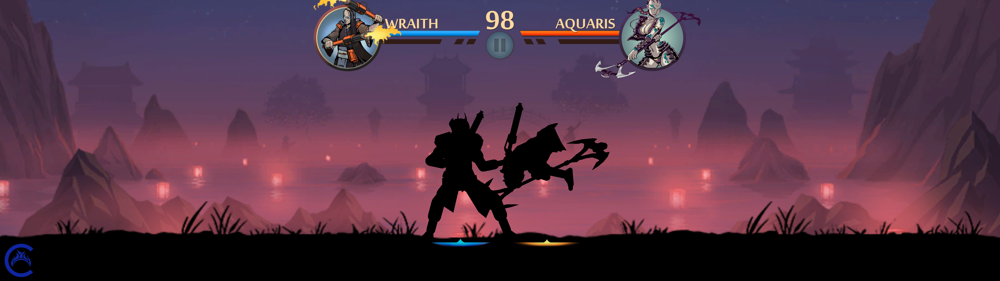](screenshots/ultrawide-night.png)

*32:9 gameplay at 5120×1440, with scenery cover scaling.*

[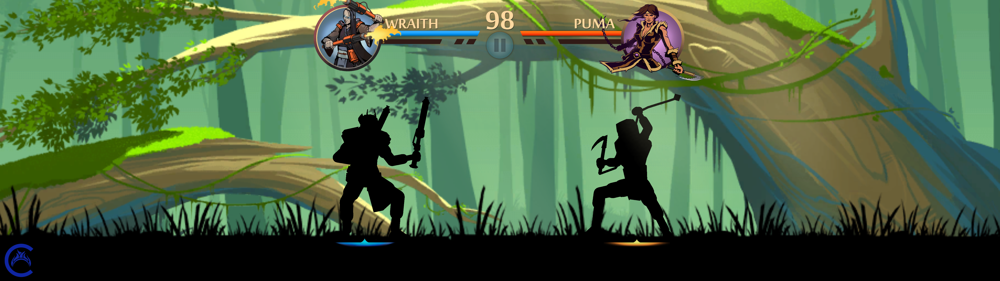](screenshots/ultrawide-forest.png)

*Forest arena at 5120×1440, with corrected fight framing and floor anchoring.*

  <a href="screenshots/sparring.png">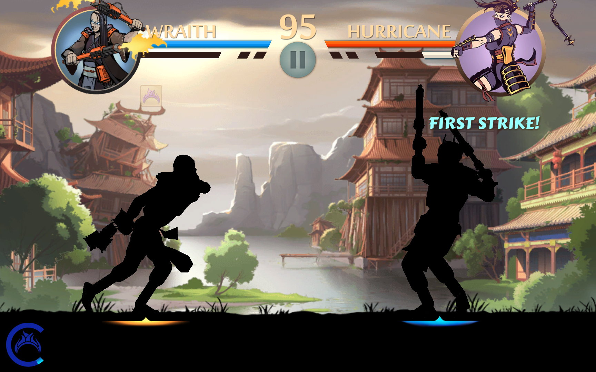</a>
  <a href="screenshots/sunset-arena.png">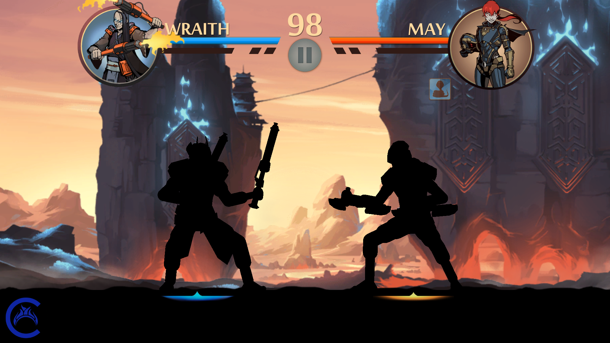</a>

*Sparring at 16:10 · Sunset arena at the original 16:9 ratio.*

## Desktop controls and menus

- **Remappable keyboard and controllers**. `[controls.keyboard]` and `[controls.gamepad]` map desktop inputs to Switch actions, including unbinding actions and sharing inputs.

- **Mouse menus**. Hover and left-click use the game's existing menu buttons. Pointer coordinates follow window resizing, black bars, HiDPI displays and configured aspect ratios; existing sliders and scroll views also receive mouse drag and wheel input.

- **Menu layout**. The bottom controller-hint strips are hidden on desktop and Android. Centered dialog prompts, combat hints and the gameplay HUD remain visible.

- **Desktop Exit button**. The main menu's localized **Exit** option closes the game and returns to the desktop, including in fullscreen.

- **Desktop configuration**. The INI also provides language selection (including system-locale detection), master volume and reverb controls. Alternate configuration and writable data locations can be selected at launch.

  <a href="screenshots/main-menu.png">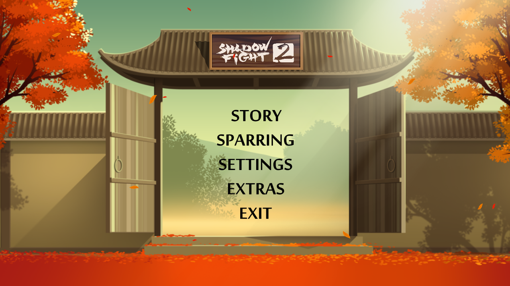</a>
  <a href="screenshots/mouse-settings.png">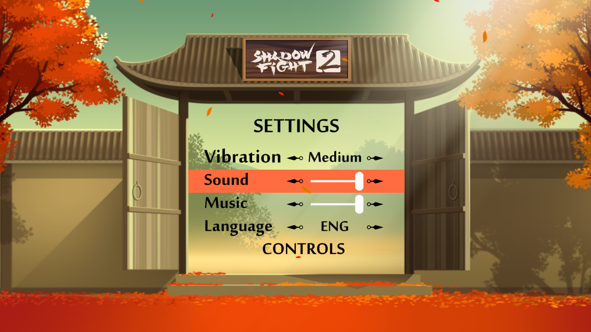</a>

*Desktop main menu and Exit option · Mouse-operated settings.*

## Sparring roster

- **Unlocked Sparring roster**. `[gameplay] unlock_all_sparring_characters = true` makes every Sparring character available without campaign progression. Enabled by default; does not change saved Story unlocks.

- **Shadow and Titan in Sparring**. Enabled by default with `[gameplay] enable_shadow_in_sparring` and `enable_titan_in_sparring`. Shadow uses his equipped campaign gear; Titan uses his own sword, ranged arm and magic. Move down past the third roster row to reveal more fighters at the original portrait size. See [roster settings](runtime-guide.md#sparring-roster).

  <a href="screenshots/character-select.png">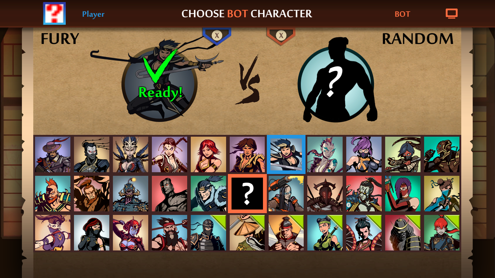</a>
  <a href="screenshots/sparring-titan.png">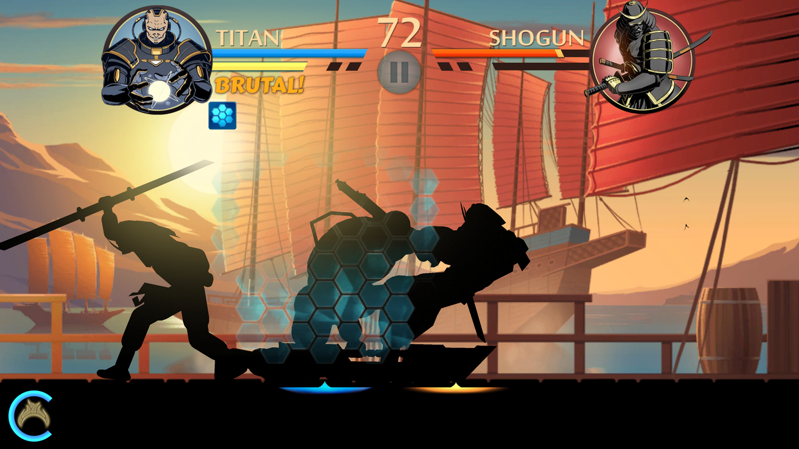</a>

*Unlocked character selection · Titan versus Shogun in Sparring.*

## Boss refights and movies

- **Boss refights and completed save**. Defeated bosses and Gates of Shadows have a Refight button with an X shortcut, including the six boss encounters after the Gates. Refights grant no rewards and leave saves unchanged. APKs and native packages bundle a completed save, selected with `[storage] use_completed_save = true`. Disabled by default; uses a separate profile.

- **Unlocked Extras movies**. `[gameplay] unlock_all_videos = true` enables gallery movie playback without changing watched-video save flags. Enabled in the supplied INI.

- **Intro and gameplay toggles**. Skip the intro with mapped A/B, Space, or a mouse click, or disable it with `[gameplay] show_intro = false`. Startup data and GPU heap preparation run during playback to reduce the wait after skipping. `ai_enabled` and `show_time_results` expose the original AI and timing-display controls.

  <a href="screenshots/boss-refight.png">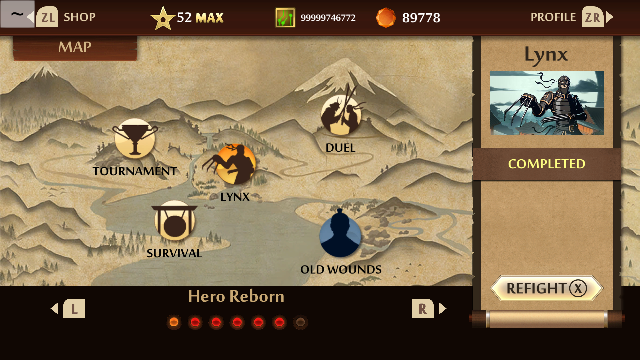</a>
  <a href="screenshots/extras-movies.png">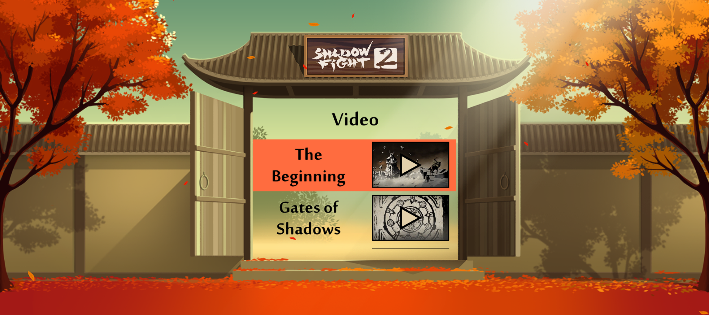</a>

*Completed Lynx encounter with Refight · Unlocked Extras movies.*

## Developer tools

- **Desktop developer console**. Opt in with `[developer] console = true`; **F1** or **backtick** opens the original console with desktop text input, command history and scrolling.

- **Fight trainer and shop cheats**. Optional `[developer] trainer` and `shop_cheats` expose the original fight controls and local shop actions through the console. Disabled by default; currency, items, levels and fight results can be saved by the game.

- **Debug overlays**. Opt in with `[developer] overlays = true`, then use **F2** to toggle the original FPS, memory, build and model/animation displays in supported scenes.

  <a href="screenshots/developer-console.png">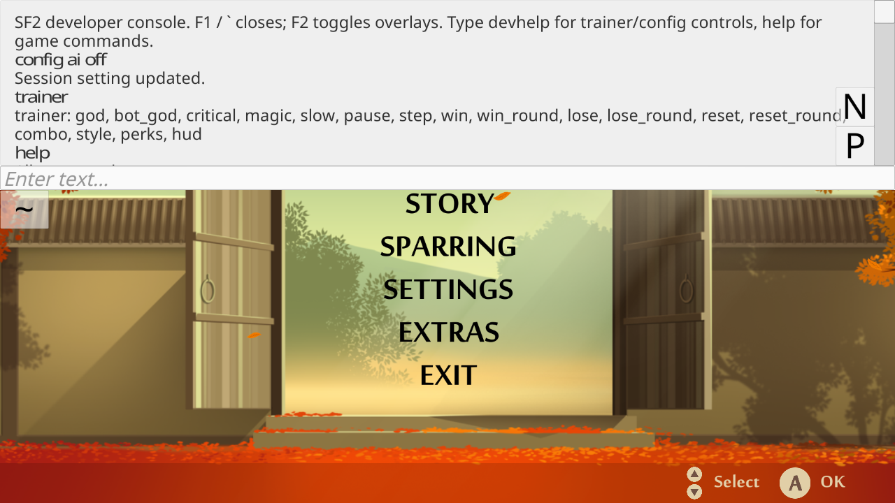</a>
  <a href="screenshots/debug-overlays.png">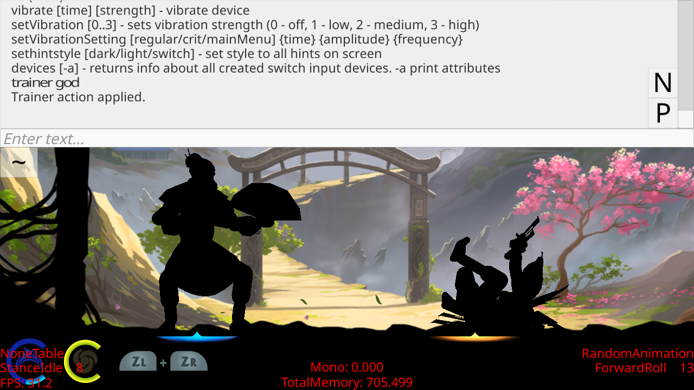</a>

*Console and trainer commands · Trainer action and combat debug overlays.*

## LAN Sparring

- **LAN Sparring (experimental)**. Native Normal/LAN and Host/Join menus, local host discovery and persistent two-player sessions. Both devices must use the same SF2Recomp release and matching roster settings. No Python launcher required. See the LAN guide.

  <a href="screenshots/lan-mode.png">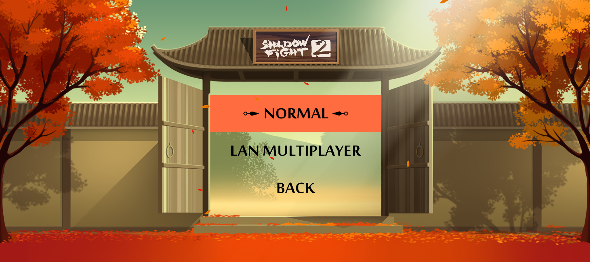</a>
  <a href="screenshots/lan-host-join.png">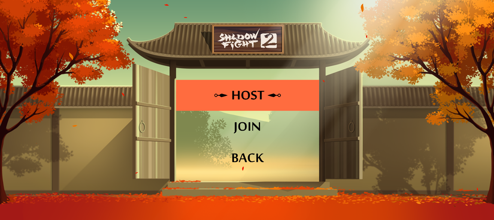</a>

*Normal and LAN choices · Native Host and Join menu.*

## Android touch controls

The Android build uses the retained mobile joystick and action buttons, with
simultaneous movement and attacks. Sparring characters with a special ability
also get a boss-power button. Keyboard and controller input remain available.
See [Android development](../README.md#android) for setup and device requirements.

[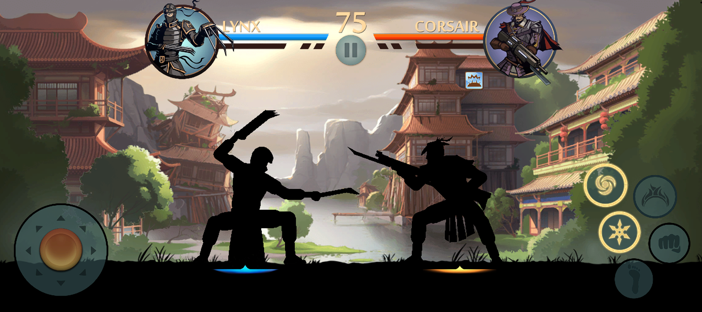](screenshots/android-sparring.png)

*Android Sparring with touch controls and Lynx's boss power ready.*

## Saves and offline settings

- **Game network blocking**. `[network] enabled = false` is the default and blocks game connections, DNS, uploads, online multiplayer, external web links and the remote developer listener. Offline Sparring remains available. Enabling networking does not implement missing online services.

- **Configurable save location and imports**. `[storage] save_directory` selects a portable or custom save folder. Existing `userdata/` backups can be imported under its `save_0/` directory.

See the settings and controls guide for setup, commands
and limitations, and the [supplied INI](../sf2recomp.ini) for shipped defaults.
Full-game stability and timing at every supported frame-rate setting remain
unverified; see [platform status](../README.md#status).
