# sf2recomp

A static recompilation of **Shadow Fight 2 for Nintendo Switch** into a native application. You supply your own extracted game files, then build the game
locally from this compiler and runtime source.

The Switch version was chosen because it includes **Sparring mode**, which offers
**offline player-versus-player (PvP)** fights.

> [!IMPORTANT]
> **No playable game files, extracted assets, keys or generated game code are included.**
> The supported game is **v1.1.0 (Switch update v131072)**.
> **Already extracted files do not require `prod.keys`.** Keys are only needed
> if you use the optional NSP extraction workflow below. Recompilation and running
> the converted game do not require keys.

[Status](#status) · [Features](#features) · [Requirements](#requirements) ·
[Getting started](#getting-started) · [NSP extraction](#optional-extract-from-an-nsp) ·
[Settings and controls](#settings-and-controls) · [Development](#development) ·
[Legal](#legal)

## Status

| Platform | Status |
| --- | --- |
| Linux x86-64 | Current development target; tested with AMD Radeon 680M, NVIDIA RTX 4070 Laptop GPU and Mesa lavapipe software Vulkan |
| Windows x86-64 | Experimental host/build/package support implemented; no verified native build. See the [Windows guide](windows.md). |
| macOS arm64 / x86-64 | Experimental host/build/conversion support implemented; native build and GPU validation pending. See the [macOS guide](macos.md). |
| Android arm64 / x86-64 | Development APKs build; API 35 x86-64 emulator verified through a completed local Sparring match, touch menus and a desktop LAN protocol connection. ARM64 phone startup and movie output verified; sustained play still needs testing. See [Android development](#android-development). |

The CPU game code runs natively, with a Vulkan renderer and SDL for windowing,
input and audio. Keyboard/controller remapping, resolution scaling, FSR 1, SMAA
and persistent saves are available. Compatibility with other GPUs remains
unverified. See the [validation notes](development.md#validation-notes) and
[working findings](findings.md) for test results and historical measurements.

## Features

The recompilation adds desktop features and graphics options beyond the Switch
release, and exposes some of the game's original developer tools. Settings below
live in **`sf2recomp.ini` beside the converted executable** and take effect after
restarting; no rebuild is needed.

Screenshots are from native Linux and Android builds. Click an image for full
resolution.

### Ultrawide and graphics

- **Aspect ratios (experimental)**. `[video] aspect_ratio` accepts `16:10`, `21:9` or `32:9`, with native screen sizes of 1728×1080, 2520×1080 and 3840×1080 before uniform scaling. Restart after changing; `original` / `16:9` is the default. In 32:9, scenery is enlarged uniformly to cover the sides, cropping some background detail vertically. Fighter and HUD proportions are preserved. Movies keep their original proportions.

- **Native display resolution**. `[video] internal_resolution = auto` or `match` renders at the window's fitted drawable pixel size, following window resizing and fullscreen. Higher resolutions improve geometry edges; bitmap artwork and font atlases retain their original detail.

- **Resolution scaling**. Fixed internal-resolution presets of `0.25x`, `0.50x`, `0.75x`, `1x`, `2x`, `3x` and `4x` let you trade rendering detail for performance, within the GPU's texture-size limit.

- **Dynamic resolution**. `[video] internal_resolution = dynamic` adjusts render scale in response to GPU load to work toward the configured frame-rate target.

- **AMD FSR 1 upscaling**. `[video] upscaler = fsr1` enables spatial upscaling and sharpening when the rendered image is smaller than its window area. Use a lower internal resolution to activate it; `auto` selects bilinear on integrated GPUs and FSR 1 on discrete GPUs.

- **SMAA anti-aliasing**. `[video] antialiasing = smaa` enables optional post-process edge smoothing. Disabled by default.

- **Configurable frame rate**. `[video] target_fps` accepts **30–360**, including targets above 60 FPS, and sets the game's target frame rate and presentation pacing. Achievable performance depends on hardware; set the host display refresh rate separately.

- **Desktop window modes**. A resizable window or fullscreen, selected with `[video] fullscreen`.

[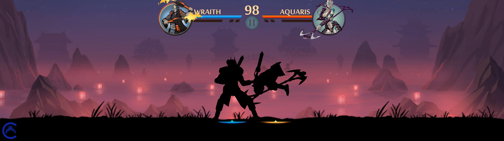](screenshots/ultrawide-night.png)

*32:9 gameplay at 5120×1440, with scenery cover scaling.*

### Desktop controls and menus

- **Remappable keyboard and controllers**. `[controls.keyboard]` and `[controls.gamepad]` map desktop inputs to Switch actions, including unbinding actions and sharing inputs.

- **Mouse menus**. Hover and left-click use the game's existing menu buttons. Pointer coordinates follow window resizing, black bars, HiDPI displays and configured aspect ratios; existing sliders and scroll views also receive mouse drag and wheel input.

- **Menu layout**. The bottom controller-hint strips are hidden on desktop and Android. Centered dialog prompts, combat hints and the gameplay HUD remain visible.

- **Desktop Exit button**. The main menu's localized **Exit** option closes the game and returns to the desktop, including in fullscreen.

- **Desktop configuration**. The INI also provides language selection (including system-locale detection), master volume and reverb controls. Alternate configuration and writable data locations can be selected at launch.

<p>
  <a href="screenshots/main-menu.png">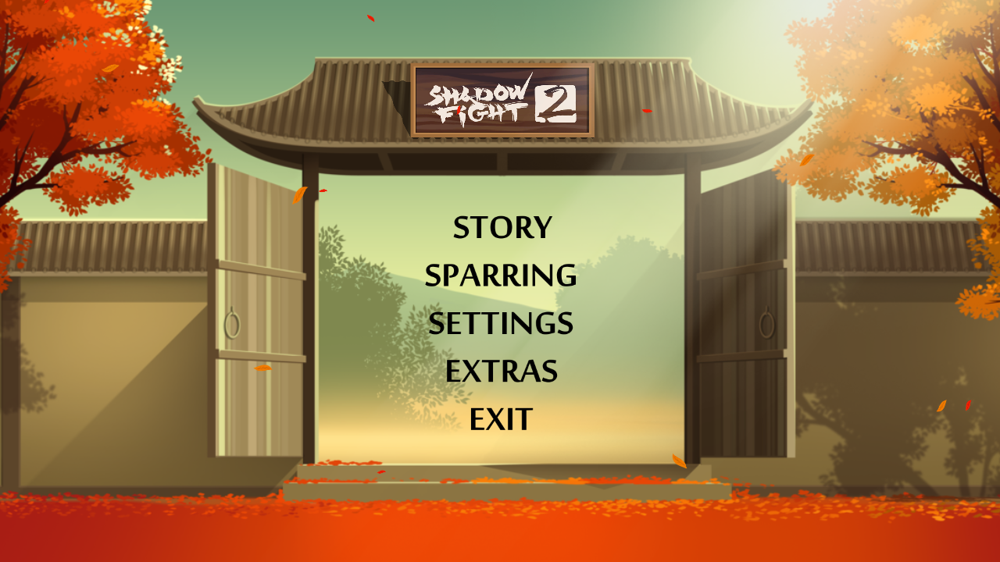</a>
  <a href="screenshots/mouse-settings.png">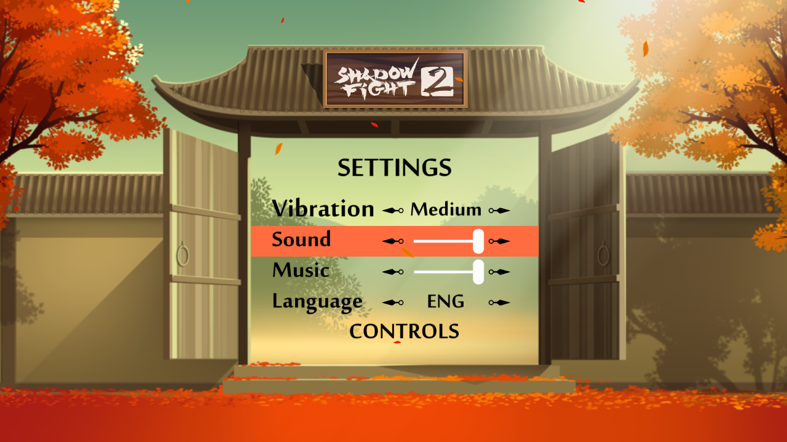</a>
</p>

*Desktop main menu and Exit option · Mouse-operated settings.*

### Sparring roster

- **Unlocked Sparring roster**. `[gameplay] unlock_all_sparring_characters = true` makes every Sparring character available without campaign progression. Enabled by default; does not change saved Story unlocks.

- **Shadow and Titan in Sparring**. Enabled by default with `[gameplay] enable_shadow_in_sparring` and `enable_titan_in_sparring`. Shadow uses his equipped campaign gear; Titan uses his own sword, ranged arm and magic. Move down past the third roster row to reveal more fighters at the original portrait size. See [roster settings](runtime-guide.md#sparring-roster).

<p>
  <a href="screenshots/character-select.png">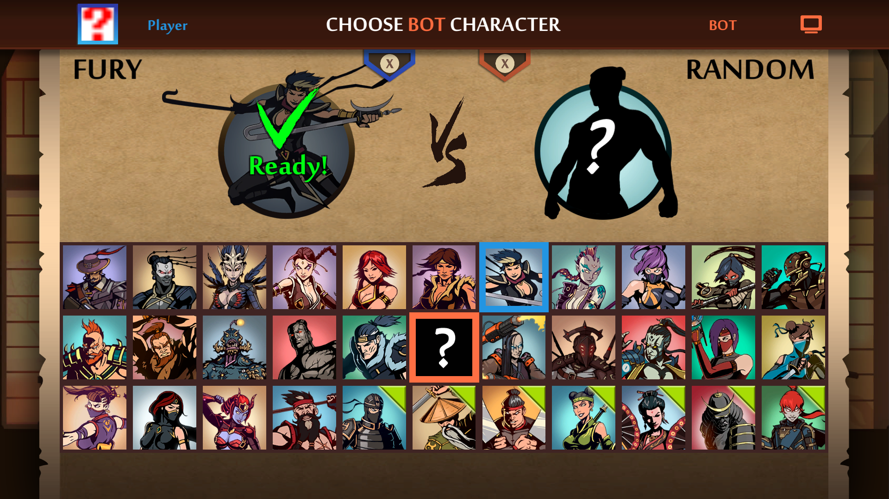</a>
  <a href="screenshots/sparring-titan.png">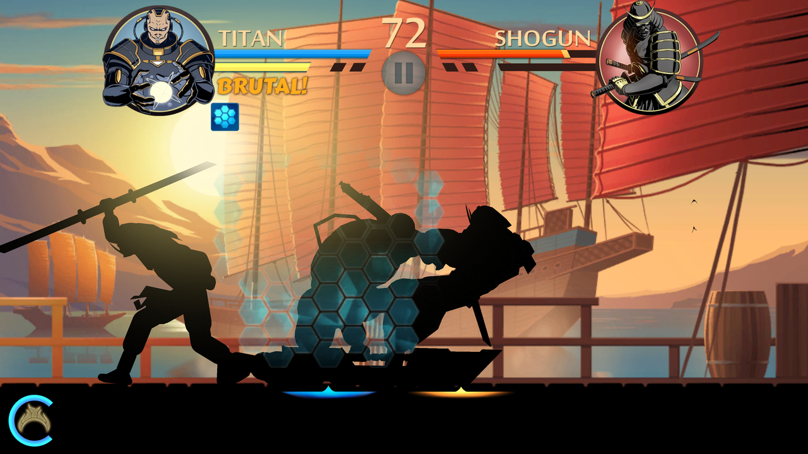</a>
</p>

*Unlocked character selection · Titan versus Shogun in Sparring.*

### Boss refights and movies

- **Boss refights and completed save**. Defeated bosses and Gates of Shadows have a Refight button with an X shortcut, including the six boss encounters after the Gates. Refights grant no rewards and leave saves unchanged. APKs and native packages bundle a completed save, selected with `[storage] use_completed_save = true`. Disabled by default; uses a separate profile.

- **Unlocked Extras movies**. `[gameplay] unlock_all_videos = true` enables gallery movie playback without changing watched-video save flags. Enabled in the supplied INI.

- **Intro and gameplay toggles**. Skip the intro with mapped A/B, Space, or a mouse click, or disable it with `[gameplay] show_intro = false`. Startup data and GPU heap preparation run during playback to reduce the wait after skipping. `ai_enabled` and `show_time_results` expose the original AI and timing-display controls.

<p>
  <a href="screenshots/boss-refight.png">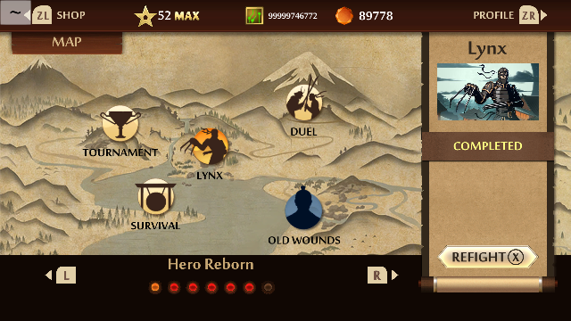</a>
  <a href="screenshots/extras-movies.png">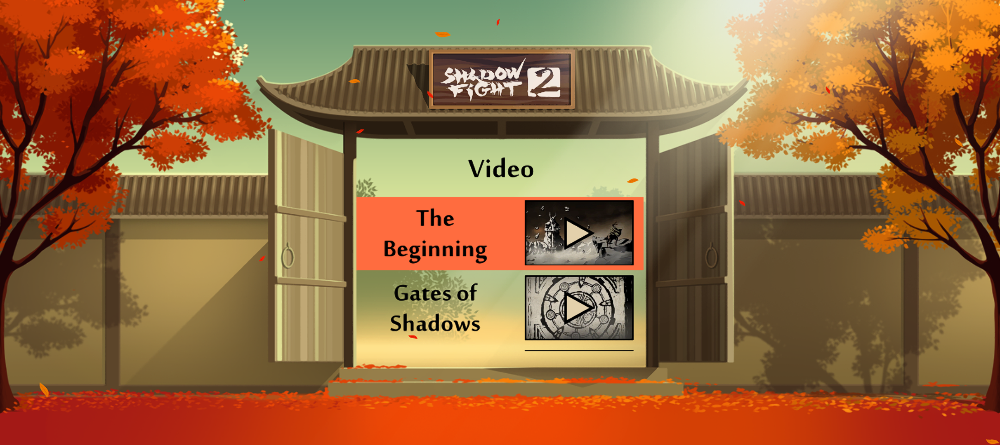</a>
</p>

*Completed Lynx encounter with Refight · Unlocked Extras movies.*

### Developer tools

- **Desktop developer console**. Opt in with `[developer] console = true`; **F1** or **backtick** opens the original console with desktop text input, command history and scrolling.

- **Fight trainer and shop cheats**. Optional `[developer] trainer` and `shop_cheats` expose the original fight controls and local shop actions through the console. Disabled by default; currency, items, levels and fight results can be saved by the game.

- **Debug overlays**. Opt in with `[developer] overlays = true`, then use **F2** to toggle the original FPS, memory, build and model/animation displays in supported scenes.

<p>
  <a href="screenshots/developer-console.png">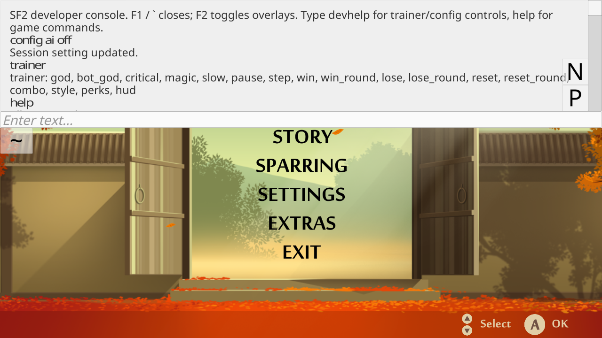</a>
  <a href="screenshots/debug-overlays.png">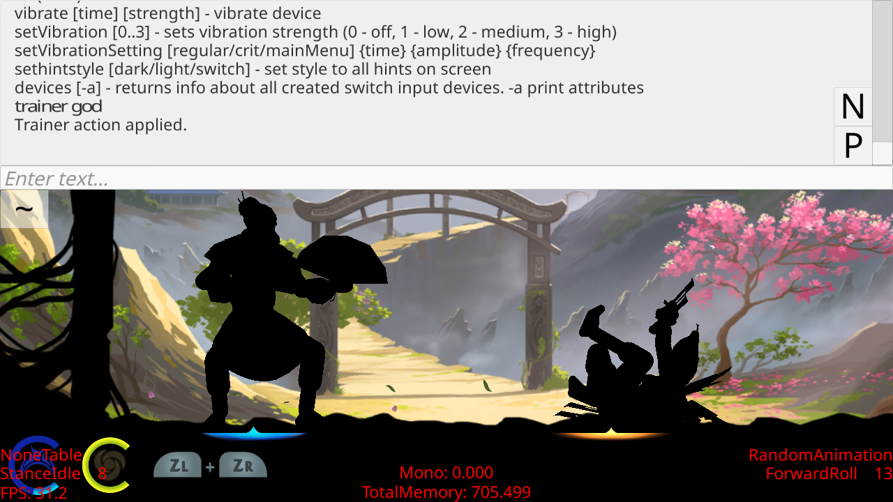</a>
</p>

*Console and trainer commands · Trainer action and combat debug overlays.*

### LAN Sparring

- **LAN Sparring (experimental)**. Native Normal/LAN and Host/Join menus, local host discovery and persistent two-player sessions. No Python launcher required. See the [LAN guide](lan-sparring.md).

<p>
  <a href="screenshots/lan-mode.png">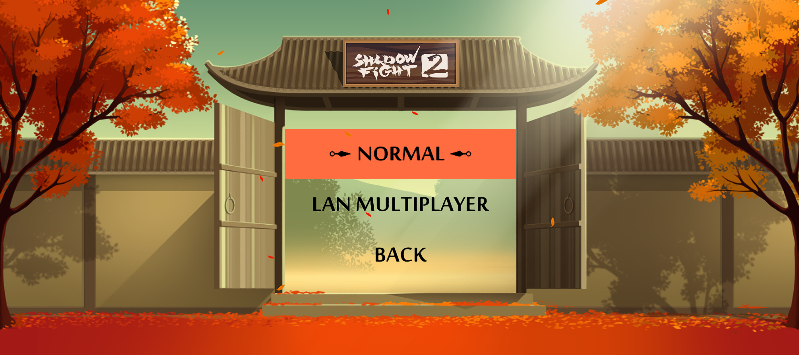</a>
  <a href="screenshots/lan-host-join.png">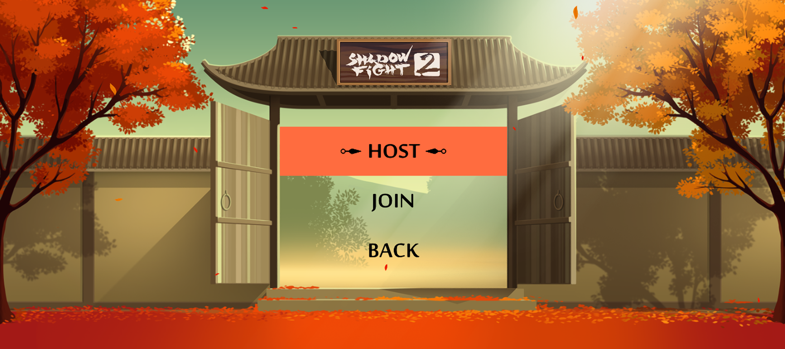</a>
</p>

*Normal and LAN choices · Native Host and Join menu.*

### Android touch controls

The Android build uses the retained mobile joystick and action buttons, with
simultaneous movement and attacks. Sparring characters with a special ability
also get a boss-power button. Keyboard and controller input remain available.
See [Android development](#android-development) for setup and device requirements.

[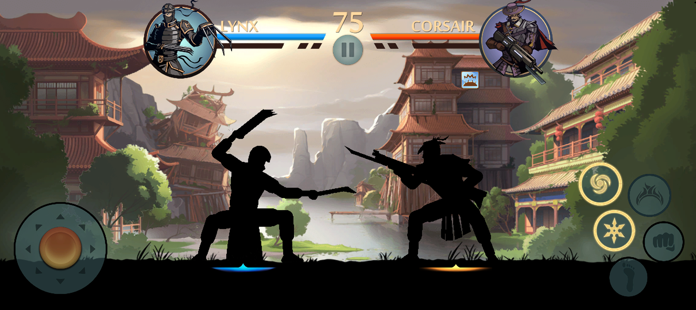](screenshots/android-sparring.png)

*Android Sparring with touch controls and Lynx's boss power ready.*

### Saves and offline settings

- **Game network blocking**. `[network] enabled = false` is the default and blocks game connections, DNS, uploads, online multiplayer, external web links and the remote developer listener. Offline Sparring remains available. Enabling networking does not implement missing online services.

- **Configurable save location and imports**. `[storage] save_directory` selects a portable or custom save folder. Existing `userdata/` backups can be imported under its `save_0/` directory.

See the [settings and controls guide](runtime-guide.md) for setup, commands
and limitations, and the [supplied INI](../sf2recomp.ini) for shipped defaults.
Full-game stability and timing at every supported frame-rate setting remain
unverified; see [Status](#status).

## Requirements

For the complete experimental Windows workflow, including local extraction and
symbol analysis, follow the [Windows guide](windows.md).
For Apple Silicon and Intel Macs, follow the [macOS guide](macos.md).

To build and convert on **Linux x86-64**, install:

- Python 3.12+ and venv/pip.
- .NET 8 **SDK** for the IL2CPP analysis tools.
- Clang/Clang++, LLD, GNU Make, CMake, Ninja, pkg-config and source download utilities.
- Vulkan 1.3+ headers/loader, shaderc, Vulkan Memory Allocator headers and the
  display/audio development libraries listed in the
  [native dependency guide](../tools/runtime-dependencies.md).

Follow that guide for distribution-specific package commands. Conversion prepares
missing SDL 3.4+, SMAA sources, fallback fonts and the bundled FFmpeg decoder
automatically. Initial setup needs network access for pinned sources and packages.
A local .NET SDK can be selected with `DOTNET=/absolute/path/to/dotnet`.

## Getting started

Run the following commands from the repository root.

### 1. Prepare your extracted game files

Use your own legally obtained files from **v1.1.0 / update v131072**, with the
update already applied. The converter expects this layout:

```text
/path/to/extracted/update/
  exefs/
    main
    sdk
    main.npdm
  romfs/
    Data/
      Managed/Metadata/global-metadata.dat
      ...                               remaining updated game assets
  control.nacp                          official game metadata
  icon.png                              matching official icon
```

Supply the complete updated RomFS. The metadata and icon are required for
packaging; `exefs` and `romfs` alone are insufficient. The converter checks the
supported main build ID, and the executable checks matching main/SDK identities
before boot.

**No `prod.keys` or tickets are needed for this workflow.** If your input is an
encrypted NSP instead, use [NSP extraction](#optional-extract-from-an-nsp).

### 2. Set up Python

After installing the native requirements above:

```sh
python3 -m venv .venv
. .venv/bin/activate
python3 -m pip install -r tools/requirements.txt
```

### 3. Build and convert

```sh
python3 tools/convert.py \
  --game "/path/to/extracted/update" \
  --output "$HOME/Games/Shadow Fight 2"
```

This generates C from your game files, compiles the native executable and creates
the output folder. Conversion builds missing analysis tools as needed and uses up
to eight compiler jobs by default; use `--jobs N` to change that.

### 4. Run

```sh
cd "$HOME/Games/Shadow Fight 2"
./sf2
```

Keep the output folder together: it contains the executable, extracted assets,
`sf2recomp.ini`, metadata, runtime libraries, fonts and license notices. System
Vulkan/shaderc and C/C++ runtime libraries remain required.

Add `--install-desktop` to the conversion command to register the game in your
user application menu. If you move the output folder, rerun conversion with that
option to update the launcher's absolute paths. Re-running conversion preserves
existing output settings and saves.

## Optional: extract from an NSP

**`prod.keys` is required only for decrypting/extracting the NSP.** It is not
required for recompilation from extracted files or for running the converted game.

After completing the requirements and Python setup above, use:

```sh
python3 tools/convert.py \
  --nsp "/path/to/Shadow Fight 2.nsp" \
  --keys "/path/to/your/prod.keys" \
  --output "$HOME/Games/Shadow Fight 2"
```

This performs extraction and then the same build and packaging steps. It takes
the update ExeFS, merges the updated RomFS over the base and extracts the official
metadata/icon. Keys remain local, are not logged and are excluded from the
converted output.

The supported input is a **combined base + update v131072 NSP containing its
CNMT XML sidecars and tickets**. Separate base/update packages, NSZ files and
other layouts are not currently supported. Extraction stages privately and
publishes only after validation succeeds.

For extraction tools, supported layouts and offline setup, see the
[tooling guide](../tools/README.md).

## Settings and controls

Edit **`sf2recomp.ini` beside the converted executable**, then restart the game.
Settings are read at launch; changing them does not require rebuilding.

Game networking is disabled by default with `[network] enabled = false`, including
DNS, uploads, multiplayer and external web links. Existing INIs without this
section also default to offline. See the [offline networking settings](runtime-guide.md#offline-networking).

| Input | Default keyboard binding |
| --- | --- |
| A / B / X / Y | K / J / L / I |
| Left stick | W / A / S / D |
| D-pad | Arrow keys |
| Plus / Minus | Return / Backspace |
| Skip intro | K, J, Space, or mouse click |

Keyboard and gamepad bindings are editable in the INI. For keyboard P1 versus
controller P2 in Sparring, set `[input] player_setup = keyboard_vs_controller`
and restart. `solo` preserves shared keyboard/first-controller P1 input;
`two_controllers` assigns one controller per player and disables keyboard gameplay
input. See [player assignment](runtime-guide.md#player-assignment).
The main menu's **Exit**
option returns to the desktop, including in fullscreen.

Saves default to `save/` inside the converted folder. Change
`[storage] save_directory` to choose another location. Sparring characters are
unlocked by default; set `[gameplay] unlock_all_sparring_characters = false`
to restore save-based unlocks.

See the [settings and controls guide](runtime-guide.md) for graphics,
language, save imports, controller prompts and optional developer tools.
The [supplied INI](../sf2recomp.ini) lists the shipped settings and bindings.

## Android development

The Android target builds a native SDL/Vulkan APK from the same generated game
code and runtime. It requires **Android 13/API 33 or newer**, a 64-bit device and
the renderer's Vulkan 1.3 features; the Vulkan version alone does not guarantee
GPU compatibility. Android uses the retained mobile joystick and action-button
UI, with independent fingers passed to Unity's touch input. Keyboard and
controller input remain available. No original Android APK is required.
Menu footer strips and the duplicate Switch combat indicators are hidden.
In Sparring selection, tap the selected fighter again to confirm; Android's
Back button/gesture goes back in menus or pauses during combat.

Use Python 3.12+, Java 17, Gradle 8.11.1, SDK platform 35, SDK CMake 3.22.1 and
NDK **28.2.13676358 (r28c)**. Set `ANDROID_HOME` to your SDK. The Gradle wrapper
downloads/reuses the pinned distribution, or `GRADLE` can select an installed
executable. Android Studio can also open the `android` project after
dependency preparation. No Android runtime libraries come from the desktop
`deps/lib` folder: SDL, shaderc and its SPIR-V dependencies are cross-compiled
from checksum-pinned sources, and the NDK supplies Vulkan headers/loader stubs.

After extracting the supported game and preparing its symbol map:

```sh
make gen SIMD=c
make android-prepare
make android                              # arm64-v8a phone build
make android ANDROID_ABI=x86_64            # emulator build
# Or build and install on the selected ADB device:
python3 tools/build_android.py --abi=arm64-v8a --install
```

Each ABI is built separately; the helper preserves its APK at
`build/android/sf2-recomp-<ABI>-debug.apk`. The Gradle output at
`android/app/build/outputs/apk/debug/app-debug.apk` contains the last ABI built.
The APK includes translated game code and the game files from your local
`game/extracted/update` directory. `--game /path/to/extracted/update` selects a
different source directory when using the Python helper. Keep the resulting APK
private like other converted output.

The launcher icon, title and display version come from the extracted official
game metadata (currently **Shadow Fight 2 · 1.1.0**). The manifest also records
the original publisher and the source NSO build ID.

Install and open **Shadow Fight 2** to start the game directly. The computer does
all conversion and packaging; the Android app has no importer or tool launcher.
On its first launch it unpacks the bundled data into private app storage, then
starts the game. Subsequent launches reuse that data. Bundled updates validate
both NSO build IDs and replace files transactionally; interrupted swaps recover
on the next launch. Editable configuration, saves and logs live in
`Android/data/org.sf2recomp.app/files` on shared storage. Existing internal INI
and saves migrate once without replacing external files. Uninstalling the app
removes its files, so back up saves and settings first. Inspect them with:

```sh
adb shell cat /sdcard/Android/data/org.sf2recomp.app/files/lasrecomp.log
adb shell cat /sdcard/Android/data/org.sf2recomp.app/files/sf2recomp.ini
```

Movies use Android's in-process MediaCodec decoder with synchronized SDL audio;
tap a video or press Android Back to skip it. The intro follows `show_intro` in
the app's INI (enabled for new installations). Existing settings are preserved.
Android defaults to `aspect_ratio = native`, matching the screen's shape while
keeping movie proportions. Sparring's Normal/LAN and Host/Join choices use the
main-menu background and layout, with a Back choice at each level.
The boss-power touch button appears only for Sparring characters with a special
ability. It continues the action buttons' zigzag layout and matches Magic's
size and palette, with one centered spiral and native cooldown/ready state. On the
default desktop keyboard layout, press **1 + 3** together (ZL + ZR) for that power;
it is separate from magic.

Development limitations: backgrounding closes the game session until guest suspension and
surface recreation are implemented; reopen the game to start a new session.
The LAN protocol and in-game Sparring flow are shared with desktop, with Android
network permissions and a foreground Wi-Fi discovery lock. ARM64-to-desktop
combat determinism, wider device compatibility and sustained play
still require validation. No original Android APK or mobile assets are required
by this target.

Source-only Android platform link checks (both ABIs):

```sh
python3 -m unittest discover -s tests -p test_android.py -v
```

Native movie checks cross-link both ABIs. To execute the synthetic video/audio
test on a connected emulator or phone:

```sh
ANDROID_MOVIE_DEVICE=emulator-5580 PYTHONPATH=tests python3 -m unittest test_android_movie -v
```

`tests/android_platform.c` can also be cross-compiled with the NDK and run via
ADB. It checks the actual guest address reservation, collision protection,
reset/protection, thread access, 128-bit atomics, tail calls, timing and paths.
The native libraries are linked for 16 KB page alignment; a 16 KB Android
device still needs its own runtime test.

Android validation (2026-11-01): an API 35 x86-64 emulator using software Vulkan
completed a local Guru-versus-Corsair Sparring match and displayed its results.
Menu taps covered Normal/LAN, Host/Join, roster selection and LAN disconnect
recovery. A desktop peer using the same native transport completed the TCP
greeting/configuration exchange through a temporary ADB tunnel; this does not
test Wi-Fi broadcast discovery or multiplayer combat synchronization. Import
tests covered malformed/truncated NSOs, wrong build IDs, rollback and interrupted
swaps. A real folder-picker rejection preserved both installed NSOs byte-for-byte.
Those import-screen tests describe the earlier development wrapper, which has
been replaced by direct game startup with bundled local assets.
Subsequent emulator checks verified bundled first-launch startup, footer-free
menu and Sparring selection, Android Back navigation, and simultaneous joystick
movement and attack fingers using the retained mobile controls. The duplicate
Switch combat indicators are hidden on Android. A footer-free desktop roster
capture is included in the README. An Android 16 ARM64 phone with an Adreno 825
also reached the game menu and produced decoded video and audio. Its driver
lacks uniform-buffer 8-bit access; that unused feature is now requested only
when supported. Sustained phone play still requires testing.
The native movie decoder passed a synthetic H.264/AAC test for frame colors,
audio output, EOF and cancellation; the full intro completed in the emulator.
Evidence is kept locally under `build/validation/android` and `build/android-*.log`.

## Development

After an initial conversion has generated the game code:

```sh
make -j8
```

Run the unit tests without game files or a GPU:

```sh
python3 -m unittest discover -s tests -v
```

- [Development and verification](development.md): regeneration, local
  launcher, GPU diagnostics and validation notes.
- [Generator guide](../tools/recompr/README.md): translating the main and SDK modules.
- [Working findings](findings.md): historical investigation notes.

## Legal

Shadow Fight 2 Recomp is an independent fan project, with no affiliation,
endorsement or sponsorship from Nekki or Nintendo. Shadow Fight 2, Nintendo
Switch and related names, trademarks and game content belong to their respective
rights holders.

This repository contains recompilation tools and runtime source, with no original
game code, game assets, game fonts, firmware, tickets or decryption keys. You must
supply your own legally obtained game files to build and play.

Conversion happens locally. The resulting executable contains translated original
game code, and the converted folder includes your supplied game assets. Keep game
files, generated code and converted output separate from public source
distributions. The project's software licenses grant no rights to that game
material.

## Licensing

Project additions use the [MIT license](../LICENSE). Imported runtime and generator
code retains its original notices; see [third-party notices](../THIRD_PARTY_NOTICES)
and [license texts](../licenses/).
